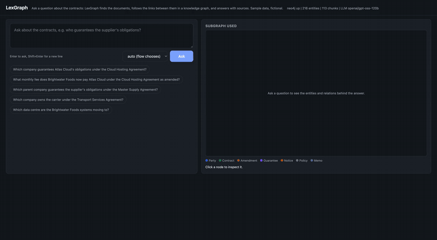
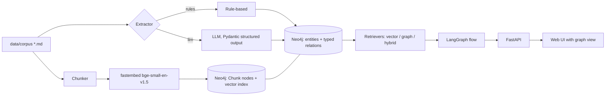
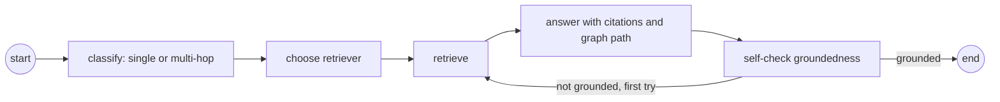
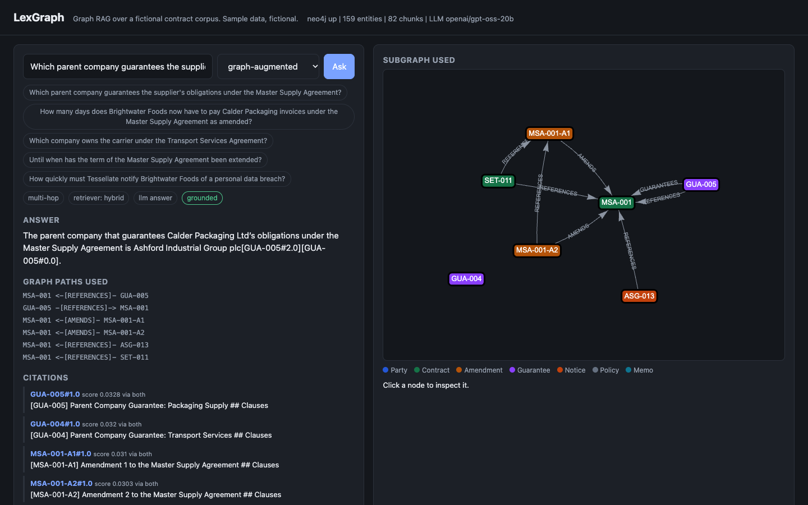
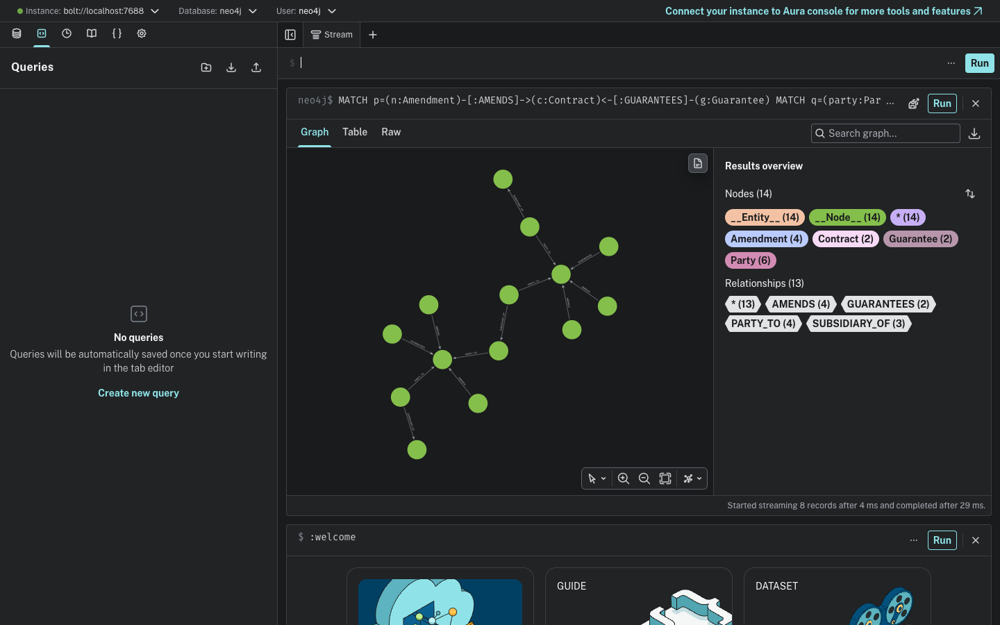
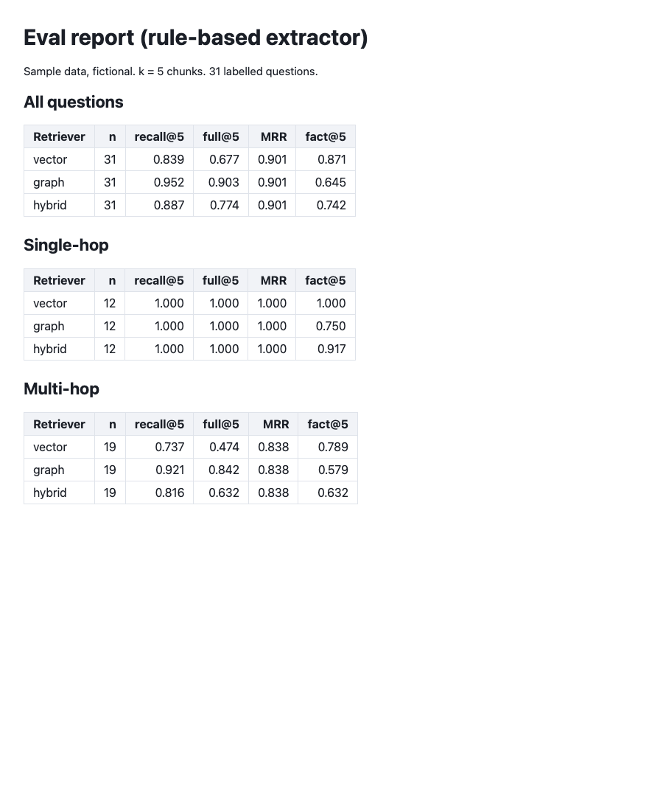

# LexGraph

[](docs/demo.mp4)

[Watch the demo video (MP4)](docs/demo.mp4)

Graph RAG over a small **synthetic** contract corpus, built with LlamaIndex, Neo4j and LangGraph. 22 short, fictional documents (contracts, amendments, guarantees, notices, group-structure memos) are turned into a property graph; questions are answered by a vector baseline, a graph-augmented retriever or a hybrid of both, and the three are compared on a labelled question set with real, reproducible numbers.

> Sample data, fictional. Every company, person and figure in `data/corpus/` was written for this project. Nothing here is legal advice or a real contract.

## Why graph RAG for this

Contract questions are often multi-hop: "Which parent company guarantees the supplier under the Master Supply Agreement?" needs the agreement (names the supplier), the guarantee (names the guarantor) and sometimes the group memo (names the parent). The words of the question only match one of those documents, so a vector search over chunks returns the agreement and its amendments and misses the guarantee. A graph stores the links (`AMENDS`, `GUARANTEES`, `REFERENCES`, `SUBSIDIARY_OF`, `PARTY_TO`) explicitly, so retrieval can start at the chunks that match, then follow edges to the documents that complete the answer, and report the path it used.

## Architecture



Graph shape: `(:Chunk)-[:FROM_DOC]->(document)`, `(:Chunk)-[:MENTIONS]->(entity)`, plus typed relations between entities. Entity types: Party, Contract, Amendment, Guarantee, Notice, Policy, Memo, Clause, Obligation, Date, Person, Jurisdiction. The schema is a Pydantic model (`lexgraph/schema.py`) shared by both extractors. Nodes are written through LlamaIndex's `Neo4jPropertyGraphStore`; chunk search uses a Neo4j vector index (over-fetched, then re-scored with exact cosine because the HNSW index is approximate).

### Retrievers

- **vector**: top-k chunks from the Neo4j vector index.
- **graph**: vector top-3 chunks give seed documents; entities named in the question (parties, document IDs, aliases) are linked as extra seeds; Cypher expands up to 3 hops over `PARTY_TO`, `AMENDS`, `SUPERSEDES`, `REFERENCES`, `GUARANTEES`, `TERMINATES`, `SUBSIDIARY_OF`, shortest-path queries connect pairs of named entities, and chunks of the reached documents are ranked by similarity times 0.9^hops (best chunk of each document first).
- **hybrid**: reciprocal rank fusion of the vector and graph rankings.

### Query flow (LangGraph)



Single-hop questions go to the vector retriever, multi-hop to hybrid; an ungrounded answer triggers one wider hybrid retry. With an LLM configured, classify, answer and self-check call it; without one, classification is a keyword heuristic, the answer is extractive (best-matching sentences, cited) and the groundedness check is lexical. The response says which mode ran.

## Results

Measured on 31 labelled questions (12 single-hop, 19 multi-hop), k = 5 chunks, graph built by the **rule-based extractor** (these committed numbers come from it, not from the LLM extractor). Retrieval metrics need no LLM. Full report: [docs/eval-report.md](docs/eval-report.md).

| Retriever | recall@5 (all) | full@5 (all) | MRR (all) | recall@5 multi-hop | full@5 multi-hop | fact@5 multi-hop |
|---|---|---|---|---|---|---|
| vector | 0.839 | 0.677 | 0.901 | 0.737 | 0.474 | 0.789 |
| graph | 0.952 | 0.903 | 0.901 | 0.921 | 0.842 | 0.579 |
| hybrid | 0.887 | 0.774 | 0.901 | 0.816 | 0.632 | 0.632 |

- recall@5: share of the gold documents (those needed to answer) found in the top-5 chunks; full@5: share of questions where all gold documents were found; MRR: reciprocal rank of the first gold document; fact@5: the gold fact string appears in the top-5 text.
- On single-hop questions all three reach recall 1.000. The graph retriever's gain is on multi-hop recall and full coverage.
- The graph retriever picks the best chunk of each reached document, which spreads the top-5 over more documents but sometimes skips the exact clause holding the fact, so its fact@5 is lower than vector's. Hybrid sits between.

LLM answers (`openai`-compatible endpoint, model `qwen/qwen3.8-27b` on Groq, lexical groundedness check), same graph, 31 questions: answer-contains-fact was 0.935 vector, 0.839 graph, 0.903 hybrid (multi-hop: 0.895 for all three). See [evals/report_rules_graph_answers.md](evals/report_rules_graph_answers.md). That run predates two small changes (graph paths shown to the model were capped at 6; extractive/lexical scoring got light stemming), and was not re-run because the free-tier daily token quota was used up. With 31 questions the differences are small; treat them as indicative.

The LLM extractor was run once for real (`openai/gpt-oss-120b` on Groq): 132 entities and 267 relations versus 159 and 273 from the rules. A retrieval comparison on that graph is **not** part of the committed numbers (the quota ran out before it could be repeated after a later fix to vector search).

Thresholds are enforced in `tests/test_evals.py`.

## Screenshots

| UI with graph view | Neo4j browser | Eval report |
|---|---|---|
|  |  |  |

The UI shot uses a live LLM answer (`openai/gpt-oss-20b` on Groq); the demo video was recorded without an LLM key (extractive answers), after the daily quota ran out.

## Setup

Requires Docker and Python 3.12.

```bash
cp .env.example .env
docker compose up -d --build          # neo4j (7475 browser / 7688 bolt), api (8001), ui (8090)
curl -X POST localhost:8001/ingest -H 'content-type: application/json' -d '{"extractor":"rules"}'
open http://localhost:8090
```

Local development:

```bash
/opt/homebrew/bin/python3.12 -m venv .venv && .venv/bin/pip install -r requirements.txt
docker compose up -d neo4j
.venv/bin/python -m lexgraph.ingest rules      # or: llm
.venv/bin/uvicorn lexgraph.api:app --port 8001
.venv/bin/pytest                               # needs Neo4j reachable
.venv/bin/python -m lexgraph.evaluation --out evals/report_rules_graph.md   # add --llm for answer-level scores
```

The embedding model (~130 MB) downloads on first use.

### Environment

| Variable | Default | Meaning |
|---|---|---|
| `NEO4J_URI` | `bolt://localhost:7688` | Bolt URL (compose api uses `bolt://neo4j:7687`) |
| `NEO4J_USER` / `NEO4J_PASSWORD` | `neo4j` / `lexgraph-pass` | local development credentials |
| `EMBEDDING_MODEL` | `BAAI/bge-small-en-v1.5` | fastembed model (384 dims) |
| `LLM_BASE_URL` | `https://api.groq.com/openai/v1` | any OpenAI-compatible endpoint (Ollama: `http://localhost:11434/v1`) |
| `LLM_API_KEY` | empty | empty means no LLM: rule extractor, extractive answers |
| `LLM_MODEL` | `openai/gpt-oss-120b` | chat model |
| `LLM_REASONING_EFFORT` | unset | optional, passed through for reasoning models |
| `TOP_K` | `5` | chunks returned |

### API

`GET /health`, `POST /ask` (`question`, `retriever` auto/vector/graph/hybrid, `k`), `GET /graph/entity/{name}`, `POST /ingest` (`extractor` rules/llm, `reset`). `/ask` returns the answer, citations (chunk ids and text), graph paths, the subgraph for the UI, and the flow trace.

## Tests and CI

41 pytest tests: extractor, Cypher builders, retrieval against Neo4j, LangGraph flow (including the retry loop with a scripted model), API, and eval thresholds. CI (`.github/workflows/ci.yml`) starts a Neo4j service container and runs ruff, pytest, the retrieval evals and a docker build.

## Limitations

- Tiny corpus (22 documents, 31 questions) written by the author on the same schema the extractor reads. The rule-based extractor is tuned to this document layout and is a reproducible baseline, not a general contract parser; the question set was written alongside the corpus, so absolute numbers are optimistic.
- Retrieval parameters (3 hops, 0.9 decay, 3 seeds) were set once, not tuned or cross-validated. Some multi-hop questions still fail, mostly ownership chains that pass through highly connected party nodes.
- The graph retriever trades exact-clause precision (fact@5) for document coverage.
- Without an LLM key the answer step is extractive and the groundedness check is lexical; these are weaker than the LLM path.
- LLM-path numbers come from one free-tier model and one run; the committed retrieval numbers do not depend on an LLM.
- No authentication, no incremental ingest, English only.

## License

MIT, see [LICENSE](LICENSE).
